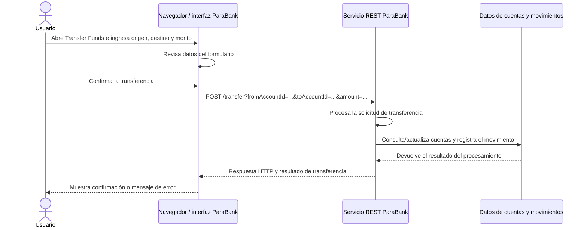

# Mapa de flujos críticos — ParaBank

**Curso:** QA Automatizador — Tecsup
**Proyecto:** Sistema de banca virtual ParaBank
**Sistema bajo prueba:** https://parabank.parasoft.com/parabank/
**Versión:** 0.1 — borrador de diseño
**Estado:** Diagrama y endpoints documentados; códigos HTTP por capturar en DevTools.

## 1. Propósito

Este documento representa cómo el navegador y los servicios de ParaBank participan en flujos críticos. Se prioriza **F04 — Transferencia de fondos**, porque modifica saldos y movimientos de cuentas. También se identifican inicio de sesión (F02) y recuperación de acceso (F06).

El diagrama es conceptual: el sitio publica una API REST de banca, pero este documento no afirma detalles internos del servidor o de su base de datos que no estén expuestos públicamente.

## 2. Diagrama cliente-servidor: transferencia



**Puntos de control QA:** los valores de origen, destino y monto deben corresponder con lo enviado; el resultado debe ser comprensible; después de confirmar, revisar los saldos y movimientos para comprobar consistencia. Las reglas para monto cero, saldo insuficiente y misma cuenta están pendientes de confirmación con el responsable del sistema.

## 3. Flujos críticos relacionados

| ID | Flujo | Solicitud del usuario | Respuesta que debe observar QA |
|---|---|---|---|
| F02 | Inicio de sesión | Enviar usuario y contraseña desde el formulario | Acceso a la cuenta o rechazo con un mensaje; no registrar contraseña en evidencias |
| F04 | Transferencia | Enviar cuenta de origen, cuenta de destino e importe | Confirmación o rechazo; revisar saldos y movimiento |
| F06 | Recuperación de acceso | Enviar los datos solicitados en *Forgot Login Info* | Mensaje de resultado sin exponer información sensible |

## 4. Endpoints REST documentados

La API pública de ParaBank publica como base `https://parabank.parasoft.com/parabank/services/bank`. Las rutas y métodos siguientes se transcriben de la especificación OpenAPI del servicio; **no equivalen a una captura de las peticiones que dispara la interfaz**.

| Flujo | Acción | Método | Endpoint documentado | Qué revisar en la respuesta | Estado HTTP visto en DevTools |
|---|---|---|---|---|---|
| F02 | Consultar autenticación | GET | `/login/{username}/{password}` | Resultado de autenticación; no compartir credenciales en capturas | Pendiente de observar |
| F03 | Consultar cuentas del cliente | GET | `/customers/{customerId}/accounts` | Lista de cuentas asociadas al cliente | Pendiente de observar |
| F03 | Consultar detalle de cuenta | GET | `/accounts/{accountId}` | Identificador y datos de la cuenta | Pendiente de observar |
| F03 | Consultar movimientos | GET | `/accounts/{accountId}/transactions` | Lista de transacciones de la cuenta | Pendiente de observar |
| F04 | Transferir fondos | POST | `/transfer?fromAccountId={id}&toAccountId={id}&amount={monto}` | Resultado de transferencia; verificar saldos y movimiento desde la interfaz | Pendiente de observar |

**Cómo completar la última columna:** en ParaBank, abrir DevTools → **Network** → filtro **Fetch/XHR**; ejecutar cada acción en la interfaz; seleccionar la petición correspondiente y anotar el método, la ruta real y el código de estado. No copiar valores de usuario, contraseña, identificadores privados ni tokens. Si la interfaz usa otra ruta, registrar la ruta observada y dejar el endpoint OpenAPI como referencia aparte.

La especificación OpenAPI declara las operaciones y sus respuestas de datos, pero no proporciona en esta tabla un código HTTP concreto observado durante una ejecución. Por eso los estados quedan pendientes y no se presentan como verificados.

## 5. Plantilla de caso de prueba

```text
clase CasoDePrueba
  atributos:
    id, titulo, flujo, objetivo, prioridad,
    precondiciones, datos, pasos,
    resultadoEsperado, resultadoObtenido,
    estado, evidencia, fecha, navegador

  métodos:
    ejecutar()
    registrarResultado(resultado, evidencia, fecha, navegador)

objeto CP-06: CasoDePrueba
  titulo = "Transferir un monto positivo entre cuentas distintas"
  flujo = "F04 — Transferencia de fondos"
  prioridad = "Alta"
  precondiciones = ["Sesión iniciada", "Dos cuentas de prueba disponibles",
                    "Saldo inicial de origen anotado"]
  datos = { origen: "cuenta A", destino: "cuenta B", monto: "S/ 1.00" }
  pasos = ["Abrir Transfer Funds", "Elegir origen y destino",
           "Ingresar monto", "Confirmar", "Revisar saldos y movimientos"]
  resultadoEsperado = "El sistema informa el resultado y los saldos/movimientos
                       corresponden con la regla de negocio confirmada."
  resultadoObtenido = "Pendiente de ejecutar y registrar"
  estado = "Pendiente"
  evidencia = "Pendiente"
```

## 6. Notas exploratorias disponibles

La imagen de notas exploratorias compartida para el proyecto indica una sesión de 20 minutos enfocada en transferencias y recuperación de acceso. Registra como hallazgos preliminares: transferencia de S/ 0.00 entre cuentas distintas, transferencia de S/ 0.00 a la misma cuenta, importe superior al saldo observado, transferencia positiva a la misma cuenta y dificultad para recuperar la cuenta. Estas notas se conservan como observaciones aportadas; **no se reproducen ni se clasifican aquí como defectos confirmados**. Deben contrastarse con las reglas de negocio y vincularse con evidencia.

## 7. Referencias y pendientes

- Sesión 4, *Cliente-servidor, HTTP, APIs y POO aplicada a testing*: laboratorio de mapa de flujos, tabla de endpoints y plantilla de caso.
- [Servicios públicos de ParaBank](https://parabank.parasoft.com/parabank/services.htm): publica el endpoint REST y enlaza su documentación.
- [Especificación OpenAPI REST de ParaBank](https://parabank.parasoft.com/parabank/services/bank/openapi.json): métodos, rutas y esquemas de respuesta.
- `docs/casos-manuales-v1.md`: definición de los flujos F01–F06 y casos de prueba manuales.
- `docs/plan-de-pruebas-v1.md`: alcance, estrategia, criterios, entorno y riesgos.

**Pendiente para completar la evidencia de la sesión:** observar en DevTools al menos cinco peticiones reales desde la interfaz y completar método, endpoint y estado HTTP. No asumir que cada operación documentada en OpenAPI es llamada por la interfaz de la misma forma.
